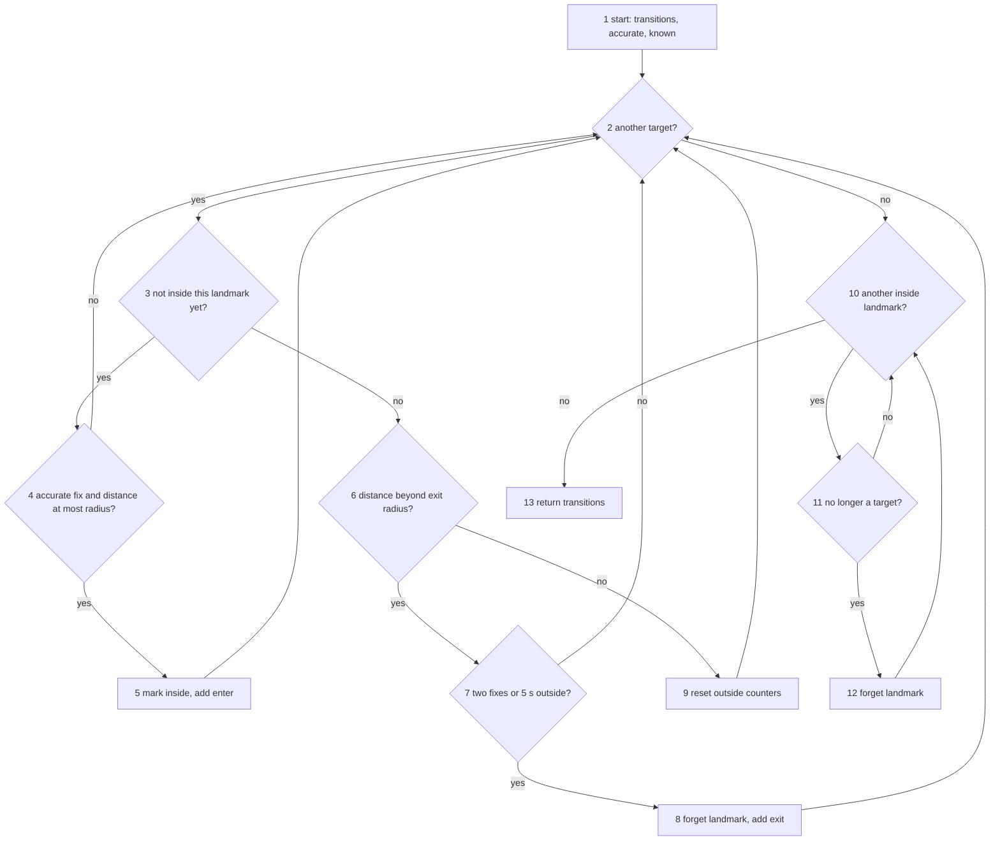

# Testing

How Singalore is tested, following the SC2006 testing lectures. `docs/DESIGN_DECISIONS.md` section 12 lists what is automated. This document holds the test design for one input (equivalence classes), the white box design for one method (control flow graph and basis paths), the coverage report, the manual system test checklist and the acceptance smoke test.

| Section | Lecture topic | Where the tests are |
| --- | --- | --- |
| 1. Equivalence classes | Black box testing: equivalence class partitioning | `apps/cms/tests/content.test.ts`, block `landmark form geofence radius equivalence classes` |
| 2. Control flow and basis paths | White box testing: control flow graph, cyclomatic complexity, basis path testing | `apps/mobile/src/modules/geofence/GeofenceEvaluator.basisPaths.test.ts` |
| 3. Coverage | Statement and branch coverage | `npm run test:coverage -w @singalore/mobile` |
| 4. Acceptance smoke test | Acceptance and end to end testing | `apps/cms/e2e/smoke.spec.ts` |
| 5. Manual system tests | System testing and test case documentation | The checklist below |

Run every automated test with `npm test`. `npm run verify` runs them together with typecheck, lint and the builds.

## 1. Equivalence classes: landmark geofence radius

Input: the **Geofence radius (m)** field on the CMS landmark form (`apps/cms/src/server/contentForms.ts`, `geofenceRadiusM`). The database enforces the same range (`check (geofence_radius_m between 15 and 100)` in `supabase/migrations/20261012000001_init.sql`).

Rule: a whole number of metres from 15 to 100.

| Class | Condition | Valid? | Representative input | Expected output | Test name |
| --- | --- | --- | --- | --- | --- |
| EC1 | Number below 15 | Invalid | `5` | Rejected: "Radius must be at least 15 m." | `EC1 below 15 m (invalid)` |
| EC2 | Whole number from 15 to 100 | Valid | `50` | Accepted as 50 | `EC2 15 to 100 m (valid)` |
| EC3 | Number above 100 | Invalid | `150` | Rejected: "Radius must be at most 100 m." | `EC3 above 100 m (invalid)` |
| EC4 | Not a whole number | Invalid | `42.7` | Rejected: "Radius must be a whole number." | `EC4 not a whole number (invalid)` |
| EC5 | Not a number | Invalid | `ten` | Rejected | `EC5 not a number (invalid)` |

The edges between the classes (14, 15, 16, 99, 100, 101) are covered by the boundary value tests in the block `landmark form boundary values (N-1)` in the same file.

## 2. Control flow and basis paths: `GeofenceEvaluator.evaluate`

Method: `evaluate(fix, targets)` in `apps/mobile/src/modules/geofence/GeofenceEvaluator.ts`. It decides, for one location fix, which landmarks the walker enters or leaves.

### Control flow graph

Each node is a statement block or a decision. Diamonds are decisions.



### Cyclomatic complexity

- Edges E = 19, nodes N = 13, so V(G) = E - N + 2 = 19 - 13 + 2 = **8**.
- Check: there are 7 decision nodes (2, 3, 4, 6, 7, 10, 11), so V(G) = 7 + 1 = **8**.

V(G) is the number of linearly independent paths, so the basis set has 8 paths.

### Basis paths

| Path | Nodes | Input | Expected output | Test name |
| --- | --- | --- | --- | --- |
| P1 | 1, 2, 10, 13 | No targets, nothing inside | No transitions | `basis path P1` |
| P2 | 1, 2, 3, 4, 2, 10, 13 | CHIJMES (radius 30 m) as target, fix 60 m away | No transitions, still outside | `basis path P2` |
| P3 | 1, 2, 3, 4, 5, 2, 10, 11, 10, 13 | Fix 5 m away with 10 m accuracy | One `enter` for CHIJMES | `basis path P3` |
| P4 | 1, 2, 3, 6, 9, 2, 10, 11, 10, 13 | Already inside, fix 40 m away (exit radius is 45 m) | No transitions, still inside | `basis path P4` |
| P5 | 1, 2, 3, 6, 7, 2, 10, 11, 10, 13 | Already inside, first fix 60 m away | No transitions, still inside | `basis path P5` |
| P6 | 1, 2, 3, 6, 7, 8, 2, 10, 13 | Already inside, second fix 60 m away | One `exit` for CHIJMES | `basis path P6` |
| P7 | 1, 2, 10, 11, 12, 10, 13 | Already inside, CHIJMES removed from the targets | No transitions, nothing inside | `basis path P7` |
| P8 | Adds one extra 10, 11, 10 pass to P1 | None possible | Infeasible | None |

P8 is **infeasible**. The cleanup loop only keeps a landmark (11 no) that the first loop entered or kept in the same call, so every 10, 11, 10 pass comes together with a pass through 5, 7 or 9. No input produces the extra pass on its own. The 7 feasible paths together cover every edge in the graph.

Nodes 4 and 7 each hold two conditions (`accurate && distance <= radius` and `two fixes || 5 s`). Counting each condition separately gives V(G) = 10. The extra condition outcomes have their own tests in `apps/mobile/src/modules/geofence/geofence.test.ts`: `ignores inaccurate fixes for entry` and `exits after 5 s outside even if fixes are sparse`.

## 3. Coverage

Jest measures coverage with its built in `--coverage` option. Run it for the whole app:

```bash
npm run test:coverage -w @singalore/mobile
```

The report goes to `apps/mobile/coverage/` (gitignored). Open `apps/mobile/coverage/lcov-report/index.html` in a browser to see each file line by line. Coverage is not part of `npm run verify`, so the gate stays as fast as before.

Geofence module on 2026-11-11:

| File | Statements | Branches | Functions | Lines |
| --- | --- | --- | --- | --- |
| `GeofenceEvaluator.ts` | 94.11% | **100%** | 60% | 94.11% |
| `GeofenceEngine.ts` | 91.79% | 82.81% | 91.17% | 92.24% |
| `promptPolicy.ts` | 100% | 100% | 100% | 100% |
| `osWindow.ts` | 92.3% | 71.42% | 87.5% | 100% |
| `backgroundArrival.ts` | 95.45% | 100% | 85.71% | 95.45% |
| All geofence files | 87.12% | 84.89% | 77.41% | 88.83% |

Every branch of `evaluate` is covered. The uncovered lines in `GeofenceEvaluator.ts` are the small `reset` and `forget` helpers. `ExpoOsGeofencer.ts` and `geofenceStore.ts` show 0% because they are thin wrappers over device APIs and are replaced by fakes in tests. They are checked by the manual tests in section 5.

## 4. Acceptance smoke test (CMS)

| ID | Name | Input | Expected output |
| --- | --- | --- | --- |
| ST1 | Content manager signs in and sees the landmark list | The seeded admin email and password on `/cms/login` | Lands on `/cms`, sees the **Landmarks** heading and at least one seeded landmark link |

The test uses Playwright and needs the local database, so it is not part of `npm run verify`. Run it like this:

```bash
npm run db:start
npm run env:local
npm run seed
npx playwright install chromium
npm run e2e
```

- `npm run db:start` starts local Supabase in Docker.
- `npm run env:local` writes `apps/cms/.env.local` with the local keys and the seeded admin login.
- `npm run seed` fills the database with the parks, landmarks and the admin account.
- `npx playwright install chromium` downloads the test browser. It is needed once per computer, and it does not change any package.
- `npm run e2e` starts the CMS if it is not running and runs the test.

Without `apps/cms/.env.local` the test fails straight away with a message that says which commands to run.

## 5. Manual system tests

Tests that automation cannot prove, because they need a real phone, real GPS or the operating system. Run them on the preview build before each demo. Copy the Result column for each run, and fill in Pass or Fail, the date and your name.

Spoofed locations (debug mode) test the geofence engine logic only. They do not exercise the operating system geofencing, so M1 must use real movement or emulator location playback.

| ID | Name | Preconditions | Input and steps | Expected output | Result (Pass or Fail, date, tester) |
| --- | --- | --- | --- | --- | --- |
| M1 | Background geofence entry | Preview build installed, location set to **Allow all the time**, at least one park downloaded | 1. Start at least 200 m from a landmark. 2. Lock the phone. 3. Walk into the landmark radius (or play an emulator route through it) | Within a few seconds a notification offers the landmark podcast. Tapping it opens the app on that podcast | |
| M2 | Lock screen and headphone controls | A podcast is playing | 1. Lock the phone. 2. Pause and play from the lock screen. 3. Pause and play with the headphone button | Playback pauses and resumes each time, and the lock screen shows the podcast title | |
| M3 | Audio focus with another app | A podcast is playing | 1. Open another audio app and play something. 2. Stop it and return to Singalore | Singalore pauses when the other app plays and does not play over it. Resuming continues from the same position | |
| M4 | Kill and relaunch during playback | A podcast is playing at a known position | 1. Swipe the app away from recent apps. 2. Open it again | A resume card offers the same podcast. Tapping it continues from about the same position | |
| M5 | Kill and relaunch during navigation | A route is being navigated | 1. Swipe the app away. 2. Open it again | The planned route is still there and navigation can continue to the remaining stops | |
| M6 | Airplane mode during a tour | Park downloaded, a tour in progress | 1. Turn on airplane mode. 2. Walk to the next landmark and play its podcast | The offline banner shows, the map and the downloaded podcast still work, and nothing crashes | |
| M7 | Low accuracy GPS near tall buildings | Walk between tall buildings (for example Raffles Place) | Walk past a landmark while the accuracy is worse than 40 m | No false arrival prompt while the accuracy is worse than 40 m. The prompt appears once the accuracy improves inside the radius | |
